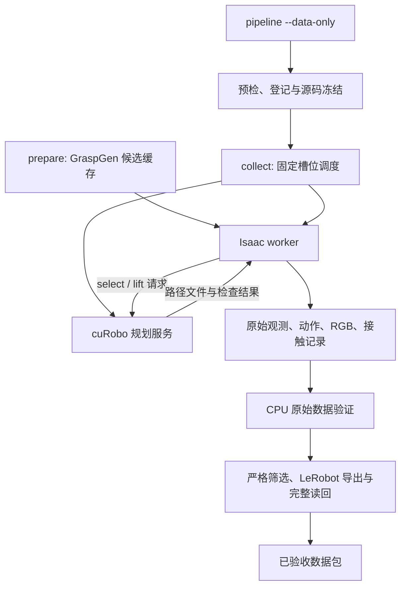

# Isaac 数采管线

本文按当前实现说明进程职责、单条回合的执行顺序和数据验收入口。运行命令见[复现手册](REPRODUCE.md)，物理规则和已验证成绩见[当前基线](BASELINE.md)。

## 支持范围

| 项目 | 当前实现 |
|---|---|
| 仿真 | Isaac Sim 5.1.0 / Isaac Lab 2.3.0，PhysX PGS |
| 机器人 | Panda，7 个臂关节和 2 个夹指关节 |
| 任务 | 已知 mesh 的抓取、抬升和稳持 |
| 物体 | `block55`、`slender95`、`cylinder36h52`、`disk56h24` |
| 场景输入 | 仿真实测物体、TCP、机器人基座及关节状态；固定桌面，可选固定墙 |
| 候选 | 官方 GraspGen，每物体单次生成并复用；默认 200，可显式设置 500／1000 |
| 控制与观测 | 60 Hz 绝对关节位置目标，480 Hz 物理；双路 256×256 RGB |
| 交付 | 原始 NPZ/NPY、接触与评分证据、严格筛选后的 LeRobot v3 |

当前规划器依赖 Panda 的关节、TCP、碰撞模型和四物体几何注册；`generic_planner.py` 的名称不表示已经支持任意机器人。双相机用于数据记录，当前抓姿和场景状态直接来自模型候选及仿真。

## 入口与进程职责

数据交付入口为 `bash run.sh pipeline --data-only ...`。`prepare` 预先生成候选；`collect` 可独立采集原始数据，`export` 可独立处理已有原始数据。

| 层 | 入口 / 实现 | 职责 |
|---|---|---|
| 启动器 | [`cli.py`](../cli.py)、[`run.sh`](../run.sh) | 分发命令和解释器；帮助可在未安装 GPU 环境时查看 |
| 数据管线 | [`tools/recoverable_pipeline.py`](../tools/recoverable_pipeline.py) | 冻结源码与配置，登记候选哈希，串联采集、导出和读回，发布完整产物 |
| 采集监督 | [`collect.py`](../collect.py)、[`resumable_collect.py`](../resumable_collect.py) | CPU 预检、固定槽位账本、GPU 分配、进程生命周期与验证队列 |
| 候选准备 | [`generate_candidates.py`](../generate_candidates.py) | mesh 点云、模型推理、物体几何筛选、缓存与来源记录 |
| 仿真 worker | [`sim_worker.py`](../sim_worker.py) | 启动 Isaac，一个进程常驻一个环境，连续执行同一物体的固定回合 |
| 回合控制 | [`runtime/collector/episode_factory.py`](../runtime/collector/episode_factory.py) | reset、select、接近、闭合、lift、稳持、实际动作记录与评分 |
| 规划服务 | [`planner_service.py`](../planner_service.py)、[`runtime/collector/generic_planner.py`](../runtime/collector/generic_planner.py) | 可复用 cuRobo 实例、世界更新、IK、路径规划、独立完整几何与自碰撞检查 |
| 原始验证 | [`runtime/validators/`](../runtime/validators) | 观测/动作/RGB 对齐、评分重放、原始子步接触核验 |
| 数据导出 | [`tools/lerobot_export/`](../tools/lerobot_export) | 严格选择、字段转换、官方完整读取和独立统计复算 |

监督进程使用标准库；GraspGen、Isaac、cuRobo、LeRobot 使用各自 Python 环境。配置变量分别为 `GRASPGEN_PYTHON`、`SIM_PYTHON`、`PLANNER_PYTHON`、`LEROBOT_PYTHON`，环境变量优先于 `local_env.json`。安装要求见[安装说明](INSTALL.md)。

Isaac worker 的 `baseline` 执行实现为 `fast_env_v2.PickupEnv`；`accelerated` 使用 `fast_env_v6.PickupEnv`，接入传感器环形调度、接触与执行器 Graph、相机调度和闭合检查/抬升规划重叠。执行优化与 `arm_speed_profile` 是两个独立配置，默认值见[当前基线](BASELINE.md)。

规划服务监听 `127.0.0.1`，每个连接处理一条带 token 的 JSON 请求。服务在锁内更新场景并执行请求，回复引用同机文件系统上的路径文件。当前正常回合使用 `select` 和 `lift` 两种请求；这是一套本机进程间协议。

| GPU 选择 | 仿真 / 规划进程布局 |
|---|---|
| 1 张，1 worker | 仿真与规划同卡，独立进程 |
| 2 张，1 worker | 第一张仿真，第二张规划 |
| 4 张，最多 3 workers | 前三张仿真，第四张共享规划器；请求串行处理 |
| 8 张，最多 8 workers | 每个启用的 worker 同卡配一个专属规划器 |

`--gpus` 按当前 `CUDA_VISIBLE_DEVICES` 的逻辑编号解释。普通采集支持以上布局；`--smoke` 和历史 `benchmark` 沿用独立调度入口及其资源限制。

## 单条回合的执行顺序

1. **登记前预检**：`initial_geometry.py` 在独立 CPU 进程中检查全部请求初态的生成/落稳几何。任一不合格即拒绝整批。`collect --dry-run` 只打印计划，不能替代预检。
2. **reset 与落稳**：加载本槽位种子、物体 XY/yaw 和初始关节，完成 120 控制周期落稳；核验实测初态、完整几何及末尾 0.5 秒静止证据。
3. **选择与规划**：核验候选来源，用实测物体位姿变换 TCP 目标；沿候选接近轴后退 5 cm 得到预抓取位姿。场景筛选后，cuRobo 规划到预抓取的路径及最后 5 cm 直线接近，完整路径通过检查后才返回。
4. **接近与闭合**：Isaac 依次执行接近、直线入抓、闭合与接触建立。动作是 9 维绝对位置目标；启用夹持反馈时，保存的是反馈修改后实际下发的两指目标。
5. **闭合检查与抬升**：用实测闭合轨迹检查完整几何，以实测抓后状态重新请求 `lift`。启用重叠时，闭合检查和规划并行，两者都通过后才执行。持物目标抬升 12 cm。
6. **稳持与保存**：要求抬高至少 6 cm，连续 120 控制周期满足原稳持和接触规则；总预算 2400 周期。保存成功与失败结果，再进行原始数据验证。

候选数、规划预算、接触与碰撞规则见[当前基线](BASELINE.md)及[候选说明](CANDIDATE_COUNT.md)。规划路径的自碰撞约束与 PhysX 动态执行需要分别理解：当前 PhysX Panda 自身碰撞关闭，不能将规划通过视为动态自碰撞验证。

## 数据与验收位置

以下路径以 `pipeline` 的输出目录为根。独立 `collect` 的输出相当于其中的 `raw/`；单条回合位于 `raw/collection/workers/<worker>/<case>/`。

| 文件 / 目录 | 用途 |
|---|---|
| `PIPELINE.json`、`source/SOURCE.json` | 登记参数、阶段日志入口、源码快照与哈希 |
| `INITIAL_GEOMETRY_PREFLIGHT.json` | 登记前整批初态预检 |
| `raw/PLAN.json`、`raw/SLOTS.json`、`raw/RUN.json` | 全部计划槽位、逐槽结果、运行完成情况 |
| 回合内 `INITIAL_STATE_AUDIT.json`、`INITIAL_STATIC_AUDIT.json` | 实际初态匹配与规划前静止核验 |
| 回合内 `select_request.json` / `select_reply.json`、`lift_request.json` / `lift_reply.json` | 规划输入及响应；仅在执行到对应阶段时存在 |
| 回合内 `planning/select/`、`planning/lift/` | 候选检查、规划路径、世界与碰撞策略记录 |
| 回合内 `trajectory.npz`、`cameras/*.npy`、`METADATA.json` | 实际状态、动作、接触、RGB 和终止原因 |
| 回合内 `VALIDATION.json`、`RAW_FORCE_VALIDATION.json` | 原始数据与物理子步力的验证结果 |
| `raw/RAW_COMMITTED.json` | pipeline 对已完成固定批次的原始记录封存 |
| `export/SELECTION.json`、`export/AUDIT.json`、`export/COMMITTED.json` | 筛选原因、官方读回及独立统计结果、数据交付封存 |
| `export/portable/dataset` | 默认单包数据集；分片模式见[导出说明](LEROBOT.md) |

N 个动作对应 N+1 帧观测，训练行使用前 N 帧及相应动作；终态另行保留。原始动作保留 7 臂关节 + 2 夹指，LeRobot 使用 7 臂关节 + 两指总开口的 8 维格式，角度单位 rad、开口单位 m。

`RUN.json` 的 `completed` 表示计划槽位已完成记账，不表示所有抓取成功。`METADATA.json` 给出单条物理结果，`SELECTION.json` 给出是否纳入数据集及排除原因，`AUDIT.json` 给出数据读回结果。应分别报告计划数、成功数、失败分类和最终导出数。

## 故障定位与恢复

| 现象 | 先检查 | 恢复边界 |
|---|---|---|
| 预检拒绝 / worker 未 READY | 命令错误、初态几何结果、规划器及 worker 启动日志 | 修正运行配置；仅明确发生在执行前的资源初始化故障允许有限重启 |
| 没找到抓姿或路径 | `METADATA.json.reason`、`planning/select/CANDIDATE_REPORT.json` | 保留规划失败槽位 |
| 闭合、抬升、稳持失败 | 回合轨迹、闭合几何结果、`planning/lift/` 和评分诊断 | 保留物理失败槽位 |
| 数据验证失败 | `SLOTS.json`、回合 `validation_attempts/` | 修复数据链路；不重新抓取该槽位 |
| 执行进度不明 | `SLOTS.json` 的 `interrupted_unknown`、worker 状态 | 停止自动恢复，保留现场 |
| 导出或读回失败 | `PIPELINE.json` 指向的阶段日志、`work/` 下失败产物 | 从封存原始数据恢复后处理 |

`pipeline --data-only --output /原目录 --resume` 使用原冻结源码和登记配置。已完成成功、规划失败及物理失败的槽位不会自动重抓，进度不明也不会自动重执行。详细状态与检查点规则见[恢复说明](RECOVERY.md)。

## 清理版验证

入口帮助、CPU 几何/初态/恢复/导出选择回归、资产预检和源码打包由 CPU CI 检查。cuRobo 导入相关单测需要规划环境；GPU 夹指回归和真实 Isaac smoke 是另两层验证。CPU CI 通过不表示在新机器上完成了物理采集，目标机器仍应按[复现手册](REPRODUCE.md)先完成两条 smoke。
